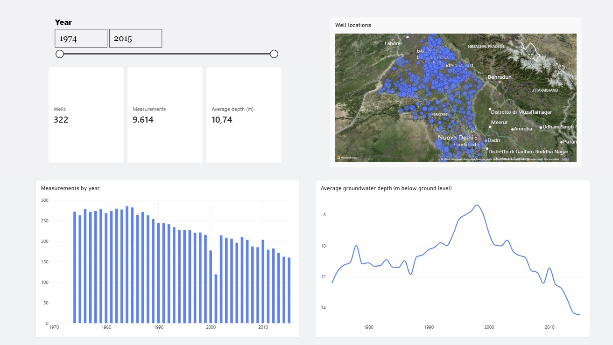
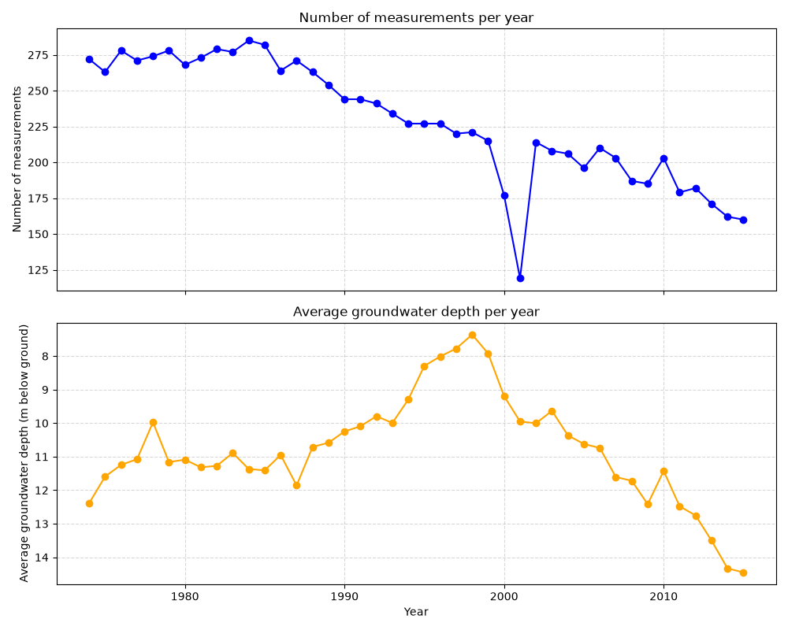

# Groundwater levels in Punjab and Haryana, 1974-2015
 
A small data pipeline I built to practise the whole path of a data project: get public data, check its quality, store it in a database and look at what it says.
 
The data are groundwater measurements from wells in northwest India. The water table in this area is a topic I care about, so I wanted my first project to be about it.
 

 
The dashboard reads the MySQL database. The Year cursor filters the valid measurements. The two charts on the rejected rows (right side) show the whole dataset and are not filtered by the cursor, because they include the years outside 1974-2015.
 

 
## What it does
 
1. Downloads the dataset and keeps the wells in India.
2. Applies four data quality rules. Every row either passes or is rejected with a reason.
3. Loads the valid rows into MySQL (tables `pozzi` and `misure`) and the rejected rows into a third table (`scarti`), all in one transaction.
4. Checks that valid rows + rejected rows = rows downloaded. If not, the pipeline stops.
5. Runs a SQL query for the average depth and the number of measurements per year, and plots the result. A Power BI dashboard reads the same database.
Running the pipeline again gives the same result: it empties the three tables and reloads them in one transaction.
 
Tools: Python, Pandas, SQLAlchemy, MySQL, Matplotlib, Power BI, Git.
 
## The data
 
The dataset is "A century of groundwater accumulation in Pakistan and northwest India", compiled by the British Geological Survey with partners in India and Pakistan (MacAllister, Krishan, Basharat, MacDonald). It was used in a paper in *Nature Geoscience* (MacAllister et al., 2022). The full file has about 68,800 rows from 4,028 observation wells in Haryana and Punjab (India) and Punjab (Pakistan), with dates from 1884 to 2020.
 
I load it with the *aqua_fetch* library (function `gw_punjab`, `data_type="full"`) and keep only the Indian wells: 717 wells and 29,172 rows. Each row is one well in one year, and the measurement is dated 1 October. Years without a measurement appear as empty rows: 8,923 of the 29,172 rows are empty, and 20,249 have a measurement.
 
Source: https://doi.org/10.5285/150c95f7-18bf-4f66-880b-8364b7257b26 (check the licence terms on the catalogue page).
 
## Data quality rules
 
Rules are applied in this order, and a row gets only the first reason that applies.
 
| Order | Reason | Rule | Rows |
|---|---|---|---|
| 1 | `misura_mancante` | the row has no measurement | 8,923 |
| 2 | `picco_isolato` | the depth differs by more than 15 m from both the previous and the next year, in the same direction | 4 |
| 3 | `poche_misure` | the well has fewer than 30 valid measurements | 4,676 |
| 4 | `fuori_periodo` | the year is outside 1974-2015 | 5,959 |
| | valid | passes all rules | 9,610 |
 
Total: 8,923 + 4 + 4,676 + 5,959 + 9,610 = 29,172.
 
Why these choices:
 
- **15 m jump.** Year-to-year changes are normally small: the 99.9th percentile of the changes is 14.5 m. A value that is more than 15 m away from both neighbours is almost certainly a typing error. The clearest case is well IND1087: about 10 m in 1989, 89.89 m in 1990, 11 m in 1991. A value that is far from only one neighbour is kept, because it can be a real change of level.
- **30 measurements.** So the trend is based mostly on the same wells over time. The count is made after rules 1 and 2, so a rejected value does not count as a good measurement.
- **1974-2015.** Around 1973 the number of wells measured each year jumps from about 150 to about 370, and I did not want to compare two different networks. 2016 and 2017 have very few measurements (70 and 62). Before 1900 there are only a few measurements per year.
## What I found
 
From 1974 to 1998 the average depth went from 12.4 m to 7.4 m, so the water table got closer to the surface. After that it dropped: by 2015 the average depth was 14.5 m, about 7 m deeper than in 1998.
 
## What this does not tell you
 
- The Indian wells in the file stop in 2017, even though the full dataset goes up to 2020.
- The dataset covers the wider Punjab region, so some of the wells are in Haryana.
- The number of measurements falls from 272 in 1974 to 160 in 2015, so the wells are not exactly the same every year.
- In 2000 and 2001 there are only 177 and 119 measurements, so those two years are less reliable.
- The order of the rules decides which reason a row gets: a row outside 1974-2015 that belongs to a well with few measurements is labelled `poche_misure`, not `fuori_periodo`.
- The spike rule only catches isolated spikes. Well IND428 swings between about 1 m and 31 m from one year to the next in 2004-2010, and the rule flags only two of those values. The rest of that series is probably unreliable too, but I cannot tell which values are true.
- The 15 m threshold comes from this dataset and would need to be checked on another one.
- The data are loaded in one go, not in blocks of years. With about 29,000 rows this is fine. Each rejected row stores the 5-year block it belongs to (`start_year`, `end_year`), so that rejections can be looked at by period.
- I only describe the trend. I do not explain why it happens.
## Database
 
Three tables in the `falde` database:
 
- `pozzi`: one row per well.
- `misure`: one row per valid measurement, linked to `pozzi` by the well code.
- `scarti`: one row per rejected row, with the reason, the 5-year block and the time of loading. It has no link to `pozzi`, because some rejected wells are not in that table.
## Fields of the dataset
 
Each row is one observation well in one year. These are the columns I import:
 
| Field | What it contains |
|---|---|
| OW_ID | code of the observation well (OW = observation well). The codes of the Indian wells start with IND, for example IND1004 |
| LOCATION | name of the place where the well is |
| LAT, LONG | coordinates of the well, in decimal degrees |
| DATE | date of the measurement, always 1 October of the year |
| WL_MBGL | groundwater level in metres below ground level (MBGL). It is the depth of the water table below the surface, so the bigger the number, the deeper the water. It is not the height of the water. Empty when the year has no measurement |
 
In the database the fields are called `ow_id`, `location`, `lat`, `longi`, `numero_data` and `wl_mbgl`.
 
## Run it yourself
 
1. Install the libraries: `pip install -r requirements.txt`
2. In MySQL, run `schema.sql` and create a user for the database.
3. Copy `.env.example` to `.env` and write your own database details.
4. Run `pipeline.py`, then `grafici.py`.
## Next
 
I want to rebuild the same pipeline on Azure and Databricks, with Delta tables, so that I can learn how it works at a larger scale. That is also the point where loading in blocks of years would make sense.